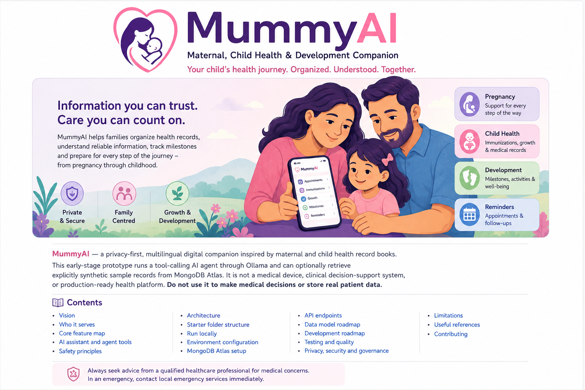

# MummyAI — Maternal, Child Health & Development Companion

<p align="center">
  
</p>

<p align="center">
  <strong>
    A privacy-first, multilingual digital health-record
    companion with a tool-using AI assistant.
  </strong>
</p>

> 
> **Project status:** Early-stage local prototype. It can run a tool-calling AI agent through Ollama and optionally retrieve explicitly synthetic sample records from MongoDB Atlas. It is not a medical device, clinical decision-support system, or production-ready health platform. Do not use it to make medical decisions or store real patient data.

MummyAI is a proposed digital companion inspired by maternal and child health record books such as Sri Lanka's Child Health Development Record (CHDR). It aims to help families organize pregnancy and child-health information, understand approved educational resources, track appointments and developmental observations, and prepare for conversations with healthcare professionals.

The long-term vision is one accessible platform that supports a family from pregnancy through childhood, while keeping healthcare professionals responsible for clinical decisions.

## Contents

- [Vision](#vision)
- [Who it serves](#who-it-serves)
- [Core feature map](#core-feature-map)
- [AI assistant and agent tools](#ai-assistant-and-agent-tools)
- [Safety principles](#safety-principles)
- [Architecture](#architecture)
- [Starter folder structure](#starter-folder-structure)
- [Run locally](#run-locally)
- [Environment configuration](#environment-configuration)
- [MongoDB Atlas setup](#mongodb-atlas-setup)
- [API endpoints](#api-endpoints)
- [Data model roadmap](#data-model-roadmap)
- [Development roadmap](#development-roadmap)
- [Testing and quality](#testing-and-quality)
- [Privacy, security and governance](#privacy-security-and-governance)
- [Limitations](#limitations)
- [Useful references](#useful-references)
- [Contributing](#contributing)

---

## Vision

**Mission:** Make reliable maternal and child health information easier to understand and organize, regardless of language, literacy level, or internet reliability.

**Product principle:** Digital records first; safe AI assistance second; clinically validated decision support only after appropriate expert review and evaluation.

### Proposed product pillars

1. **Digital maternal and child health record** — structured records from pregnancy, birth, infancy and childhood.
2. **Conversational AI companion** — parents can ask questions in natural language and receive understandable, source-grounded educational answers.
3. **Personalized record assistant** — with authorization, the agent can retrieve relevant records, summarize trends and prepare clinic-visit questions.
4. **Preventive-care organizer** — reminders for appointments, immunizations and follow-up tasks using approved schedules.
5. **Child development support** — age-appropriate milestone observations, learning activities and referral prompts without diagnosing a child.
6. **Professional workspace** — authorized health workers can review records, verify extracted data and document follow-up.
7. **Accessible and multilingual design** — Sinhala, Tamil and English, with future voice-first and low-connectivity support.

## Who it serves

- **Pregnant mothers:** antenatal visits, pregnancy education, preparation for birth and postpartum follow-up.
- **Parents and caregivers:** a child's record, vaccination history, growth entries, developmental observations and reminders.
- **Public health midwives and healthcare workers:** authorized record review, follow-up workflows and source verification.
- **Doctors and specialists:** concise, consent-based summaries and referral context.
- **Administrators:** account and content management, system monitoring and privacy-preserving aggregate reporting.

Roles must be separated using least-privilege access. Administrative access must not automatically grant access to every private health record.

## Core feature map

### 1. Pregnancy and maternal health
- Pregnancy profile, pregnancy history and estimated due date.
- Antenatal appointment history and upcoming visits.
- Clinician-recorded measurements, investigations and reports.
- Allergies, relevant medical history and recorded prescriptions.
- Stage-appropriate education from reviewed resources.
- Birth preparation checklist and postpartum follow-up.
- Appointment reminders and a summary for the next clinic visit.

### 2. Birth and newborn record
- Birth date, time and place.
- Birth measurements and gestational age, where recorded.
- Delivery, newborn examination and relevant care information.
- Screening and follow-up records.
- Feeding support and discharge instructions.
- Missing, pending, unconfirmed and verified information states.

### 3. Digital child health record
- Child profile and authorized caregiver relationships.
- Medical history, allergies and relevant conditions.
- Clinic visits, hospital summaries and supporting documents.
- Immunization history and appointment schedule.
- Growth measurements and charts.
- Nutrition, feeding, sleep and activity observations.
- Dental, vision, hearing and other screening records where applicable.
- Downloadable or printable summaries for professional review.

### 4. Growth monitoring
- Weight, length/height and age-appropriate measurements.
- Growth charts and longitudinal trends.
- Appropriate WHO growth standards and indicators, once validated.
- Unit checks, implausible-entry warnings and measurement provenance.
- Explanations in simple language.
- Flag possible concerns for professional review; never diagnose from one value.

### 5. Immunization and preventive care
- Configurable national immunization schedule.
- Vaccine, dose, date and facility details where available.
- Upcoming and overdue reminders.
- Follow-up workflow for missed appointments.
- Routine clinic and screening reminders.
- Schedule updates reviewed and approved by designated health professionals.

### 6. Child development and well-being
- Gross motor, fine motor, language, cognitive, social and emotional observations.
- Age-appropriate play and communication suggestions.
- Validated screening workflows only when appropriate and authorized.
- Parent notes and developmental timelines.
- Sleep, behaviour and emotional-well-being observations.
- Referral prompts for professional assessment when concerns warrant it.
- No diagnosis of autism, ADHD, depression, developmental disability or other conditions from chatbot conversations alone.

### 7. Parent AI chatbot
- Ask general questions about pregnancy, newborn care, child health, parenting and development.
- Personalized answers based on the selected child's authorized record.
- Sinhala, Tamil and English interface, with quality-validated language support.
- Text input first; voice, transcription and text-to-speech as later milestones.
- Conversation history separated by child and topic.
- Simple explanations of health terminology.
- Follow-up questions when essential information is missing.
- Source citations and clear separation between recorded facts and general education.
- Upload document/image for explanation as a later, controlled feature.
- Clear uncertainty statements and appropriate professional-care guidance.

### 8. AI agent tools
- **Record retrieval:** retrieve only the authorized child's relevant records.
- **Health calculations:** tested application code for dates and approved calculations.
- **Knowledge search:** retrieve approved, versioned educational material and clinical guidance.
- **Reminder creation:** propose or create authorized reminders after required confirmation.
- **Document extraction:** OCR/extraction with user or clinician confirmation before saving.
- **Trend summary:** summarize verified dated measurements without over-interpreting.
- **Clinic summary:** prepare a draft summary for the parent or professional to review.
- **Referral workflow:** draft a request for human review; do not autonomously diagnose or refer without the required workflow.
- **Notification delivery:** use consented channels and avoid exposing sensitive content in notifications.

### 9. Multimodal features (planned)
- Voice input and spoken answers.
- Scan paper record-book pages and extract candidate fields.
- OCR for dates, tables, printed and handwritten text where supported.
- Blur/crop checks and request a clearer image when needed.
- Show extracted values alongside the original source.
- Let a parent or authorized health worker confirm or correct each field.
- Keep source file, extraction model/version and verification state.
- Never silently turn uncertain extracted data into verified medical facts.

### 10. Family companion
- Multiple child profiles with independent histories.
- Caregiver permissions and shared care tasks.
- Appointment calendar and preparation checklists.
- Feeding, sleep and daily observation logs where useful.
- Parent journal and questions for the next clinic visit.
- Accessible text size, audio support and simple-language interface.
- Future offline access to previously saved essential records and secure synchronization.

### 11. Healthcare professional workspace (planned)
- Authorized patient search and record review.
- Enter and verify clinic measurements.
- Review AI-extracted values and summaries.
- Growth charts and relevant longitudinal trends.
- Follow-up and referral task tracking.
- Document alert review and outcomes.
- Audit trail for sensitive actions.
- AI outputs remain drafts until reviewed where clinical use is intended.

### 12. Administration and public-health analytics (planned)
- Role and clinic management.
- Versioned approved educational content and schedules.
- Reminder delivery and service-health monitoring.
- Aggregate follow-up and vaccination reporting where legally authorized.
- Privacy-preserving analytics and small-cell suppression where needed.
- AI quality, safety incident and user feedback monitoring.
- Data retention, export and account-closure workflows.

## AI assistant and agent tools

A normal chatbot produces text. An agent can call explicitly defined tools, validate results and complete permitted tasks. MummyAI should use a **restricted tool allowlist** and enforce permissions in the backend on every tool call.

### Example question flow

1. A parent asks: “Can you summarize my child's last three recorded weights?”
2. The backend authenticates the user and confirms access to the selected child.
3. The agent calls a narrow record-retrieval tool.
4. The backend returns only relevant, authorized, dated measurements.
5. Application code validates units and ordering.
6. The assistant explains the recorded trend, notes missing data, and avoids diagnosing.
7. Any saved action (such as creating a reminder) requires the correct permission and, where appropriate, explicit confirmation.

### Agent design rules
- Never expose unrestricted SQL, shell, file-system or general database tools to the model.
- Validate every tool argument against a schema.
- Authorize every record read and write server-side.
- Use deterministic, tested code for calculations.
- Retrieve relevant passages from an approved knowledge base rather than relying only on model memory.
- Store provenance and guideline version for health education.
- Treat user-uploaded documents and retrieved content as untrusted input.
- Require confirmation before consequential writes or notifications.
- Keep a privacy-conscious audit trail of tool actions.
- Do not allow the model to modify verified clinical records directly.
- Do not make autonomous diagnosis, medication changes, triage clearance or treatment decisions.

## Safety principles

MummyAI is intended to support education and organization, not replace healthcare professionals.

- **Urgent symptoms:** provide clear, approved instructions to seek immediate medical care; do not delay with a long chatbot interview.
- **No false reassurance:** absence of an alert does not prove that a person is safe.
- **No unsupported diagnosis:** do not diagnose from a single measurement, image or chat message.
- **No prescription changes:** do not start, stop or change medicines or doses.
- **Source transparency:** show whether a response came from a record, approved reference or general educational explanation.
- **Human oversight:** professional review is required for consequential clinical workflows.
- **Uncertainty:** ask a relevant follow-up or say when the system cannot answer safely.
- **Data quality:** missing information is not the same as a normal result.
- **Age-appropriate privacy:** design for children's rights, guardian authorization and evolving autonomy.

## Architecture

### Starter architecture

```text
Browser / Mobile Web
        |
        v
React + Vite frontend
        |
        v
Express API ---- Authentication / authorization (to implement)
        |
        +---- Restricted Ollama tool-calling agent (local; optional demo mode)
        |
        +---- Approved knowledge retrieval (planned)
        |
        +---- Read-only synthetic-record tools
        |
        +---- MongoDB Atlas (optional; synthetic examples only)
        |
        +---- Private object storage (planned)
        |
        +---- Background reminder worker (planned)
```

### Recommended production stack

| Layer | Suggested option |
|---|---|
| Frontend | React + TypeScript + Vite |
| Backend | Node.js + Express or NestJS + TypeScript |
| Database | MongoDB Atlas in this prototype; choose and review a production database before real health data |
| File storage | Private encrypted object storage |
| AI | Server-side model API with tool-calling support |
| Knowledge retrieval | RAG over approved, versioned sources |
| Authentication | Secure session or carefully implemented token flow |
| Background tasks | Queue + scheduler for reminders |
| Charts | Recharts or Chart.js |
| OCR | OCR service/library followed by validation and confirmation |
| Deployment | Hosting assessed for applicable privacy and health-data requirements |

The current MongoDB integration is deliberately limited to fictional sample records. Production health records require authentication, per-record authorization, consent, auditability, retention/deletion controls, encryption, backups, and legal/clinical review regardless of database choice.

## Starter folder structure

```text
MummyAI_Starter/
├── README.md
├── .gitignore
├── docs/
│   ├── ARCHITECTURE.md
│   ├── SAFETY.md
│   └── ROADMAP.md
├── backend/
│   ├── package.json
│   ├── .env.example
│   ├── src/
│   │   ├── agent.js
│   │   ├── database.js
│   │   └── server.js
│   └── test/
│       └── agent.test.js
└── frontend/
    ├── package.json
    ├── index.html
    └── src/
        ├── main.jsx
        ├── App.jsx
        └── style.css
```

This is intentionally a small scaffold so the first run is easy to understand. It includes local Ollama chat and optional persistence for synthetic examples only. It is **not** a complete clinical record system: authentication, caregiver authorization, real-record access, reminders, approved medical sources, audit logging and clinical review workflows must be implemented before any real health data is used.

## Run locally

### Requirements
- Node.js 20 or newer recommended.
- npm.
- An editor such as VS Code.

### 1. Install and start Ollama

Install Ollama from [ollama.com/download](https://ollama.com/download), then open PowerShell and run:

```powershell
ollama pull llama3.2
ollama serve
```

Ollama normally runs as a background service after installation. If `ollama serve` reports that the port is already in use, the service is already running. Confirm the model is installed with `ollama list`.

### 2. Configure and start the backend

In the project terminal:

```powershell
cd backend
npm.cmd install    
if (-not (Test-Path .env)) { Copy-Item .env.example .env }
npm.cmd run dev
```

The default configuration uses the Ollama service at `http://localhost:11434` and model `llama3.2:latest`. Update `OLLAMA_BASE_URL` or `OLLAMA_MODEL` in `backend/.env` if needed. Choose a model with tool-calling support.

### Connect MongoDB Atlas (optional)

1. Create a MongoDB Atlas project and cluster in your own Atlas account.
2. Create a database user with a strong, unique password. For this prototype, grant access only to the `mummyai` database.
3. In Atlas **Network Access**, allow your current development IP. Avoid `0.0.0.0/0`.
4. Select **Connect → Drivers → Node.js** and copy the connection URI.
5. Put the URI in `backend/.env` as `MONGODB_URI=...` (replace the password placeholder; URL-encode special characters in credentials). Never paste it into chat, frontend variables, or source control.
6. Restart the backend. Check `http://localhost:4000/api/health`; `database.status` should be `connected`. The UI shows the fictional profiles when the connection is working; the JSON endpoint is `GET /api/demo/children`.

At startup, `SEED_SYNTHETIC_DATA=true` inserts two fictional sample child profiles into the `child_records` collection if they are not already present. The agent can list these profiles and read their fictional visit entries using restricted tools. The database code only reads records marked `isSynthetic: true`; this prototype does not support real patient records, accounts, or authorization. If you do not configure Atlas, the chatbot still works for general questions, but record tools return a clear database-not-configured error.

Backend default URL: `http://localhost:4000`

### 3. Start the frontend

Open a second terminal:

```powershell
cd frontend
npm.cmd install
npm.cmd run dev
```

Open the local URL printed by Vite (typically `http://localhost:5173`).

### 4. Try the chat

Use the chat panel to ask a general question. The agent uses the local Ollama model. Its restricted tools can explain prototype capabilities, prepare general questions for a clinic visit, and (when Atlas is connected) list/read the fictional sample profiles. It does not search reviewed medical sources, schedule reminders, or provide clinically validated advice. Set `AI_MODE=demo` in `backend/.env` to use fixed demo responses instead.

With the default local setup, prompts are sent to your local Ollama service and are not sent to a hosted AI provider by this application. Do not enter real names, identity numbers, or private health information; this prototype has no authentication or clinical-grade privacy controls.

### Windows note

If PowerShell blocks `npm`, try `npm.cmd` (for example, `npm.cmd run dev`).

## Environment configuration

`backend/.env.example`:

```dotenv
PORT=4000
FRONTEND_ORIGIN=http://localhost:5173
# Local Ollama service address
OLLAMA_BASE_URL=http://localhost:11434
# Must be installed with `ollama pull llama3.2`
OLLAMA_MODEL=llama3.2:latest
# Optional Atlas URI; leave blank to run without database features.
MONGODB_URI=
MONGODB_DB=mummyai
# Only inserts fictional examples; not real patient data.
SEED_SYNTHETIC_DATA=true
# Set to "demo" to disable Ollama.
AI_MODE=agent
```

The prototype rate-limits chat requests and uses security headers, but has no authentication, reviewed knowledge base, or real-record access; do not use it with real patient data.

## MongoDB Atlas setup

The backend uses Mongoose to connect to Atlas. It creates the `child_records` collection when the synthetic samples are first seeded. Database status is reported by `GET /api/health`. Keep the Atlas URI only in the ignored `backend/.env` file. Use Atlas network access restrictions and a database user limited to this app's database.

The demo record tools are intentionally read-only and filter every query to `isSynthetic: true`. Do not remove this guard or add real records until authentication, per-child authorization, consent, audit logging, encryption, retention/deletion workflows, and clinical/privacy review are implemented.

## API endpoints

| Method | Endpoint | Purpose |
|---|---|---|
| `GET` | `/api/health` | API, Ollama mode/model, and MongoDB connection status |
| `GET` | `/api/demo/children` | Read-only list of records marked synthetic; returns 503 if Atlas is unavailable |
| `POST` | `/api/chat` | Restricted local Ollama agent by default; fixed demo response when `AI_MODE=demo` |

Example request:

```json
{
  "message": "What questions could I ask at my child's next clinic visit?",
  "language": "en"
}
```

The endpoint does not provide personalized medical advice or access real child profiles. Tools are read-only: prototype information, clinic-question preparation, and optional fictional sample records. Add authentication, reviewed sources, clinical safety evaluation and record-level authorization before extending it. Chat requests are limited to 20 per minute per client in this single-process prototype.

## Data model roadmap

Potential relational tables:

- `users`
- `caregiver_profiles`
- `children`
- `care_relationships`
- `pregnancies`
- `birth_records`
- `medical_records`
- `clinic_visits`
- `measurements`
- `growth_assessments`
- `immunizations`
- `development_records`
- `documents`
- `medication_records`
- `reminders`
- `ai_conversations`
- `ai_tool_events`
- `referrals`
- `consents`
- `audit_logs`

Each record should include appropriate identifiers, timestamps, source/provenance, verification status and access policy. Avoid storing unnecessary identifiers or free-text sensitive details. Design retention and deletion with legal obligations and clinical record requirements in mind.

Suggested provenance states:
- `parent_entered`
- `ai_extracted_unverified`
- `imported_from_authorized_source`
- `clinician_verified`

An AI extraction must never silently overwrite a clinician-verified value.

## Development roadmap

### Phase 1 — Safe MVP
- [ ] Responsive landing page and language selector.
- [ ] Registration/login UI, then secure server-side authentication.
- [ ] Parent and child profiles with caregiver authorization.
- [ ] Pregnancy, birth and basic child health record forms.
- [ ] Measurements and growth-chart visualization.
- [ ] Immunization and appointment records.
- [ ] General chatbot connected to reviewed health resources.
- [ ] Personalized read-only record retrieval after authorization.
- [ ] Consent, audit logging, backup and recovery.
- [ ] Synthetic-data tests and safety evaluation.

### Phase 2 — AI assistance
- [x] Restricted tool calling with schema validation (prototype capability and clinic-question tools only; no record access or writes).
- [ ] RAG over approved, versioned knowledge.
- [ ] Clinic-visit summary generation.
- [ ] Reminders and notification preferences.
- [ ] Document upload and OCR with confirmation.
- [ ] Sinhala and Tamil quality evaluation.
- [ ] Voice input and text-to-speech.
- [ ] Developmental observation and validated screening workflows.

### Phase 3 — Professional workflows
- [ ] Clinician and midwife dashboard.
- [ ] Verified measurement entry and review.
- [ ] Referral and follow-up tracking.
- [ ] Clinical review of alert rules.
- [ ] Authorized integrations with health systems.
- [ ] Offline-first sync and conflict handling.
- [ ] Privacy-preserving aggregate reporting.
- [ ] Pilot evaluation, governance approval and incident response.

## Testing and quality

At minimum, test:
- Authentication and authorization boundaries, especially access to another family's child record.
- Date calculations, units and measurement validation.
- Missing, duplicated and conflicting health data.
- AI answers that contradict the record or invent a value.
- Emergency and urgent-symptom handling.
- Prompt injection in uploaded documents and retrieved content.
- Unauthorized tool calls and writes.
- Reminder time zones, duplicate notifications and failed delivery.
- Sinhala and Tamil medical translation quality with qualified reviewers.
- Backup restoration, audit integrity and deletion/retention workflows.

The current MongoDB-backed examples are synthetic. Continue using synthetic data until appropriate legal, ethical, security and clinical approvals are in place.

## Privacy, security and governance

Before any real-world deployment:
- Complete a privacy and security risk assessment.
- Confirm applicable Sri Lankan data-protection requirements and health-sector obligations with qualified legal and clinical advisors.
- Obtain appropriate consent and verify guardian authority.
- Use least-privilege role-based access and per-record authorization.
- Encrypt data in transit and at rest; protect backups and file storage.
- Keep API keys and credentials server-side.
- Keep model prompts local where required, minimize any data sent to providers, and review provider retention/training settings.
- Keep audit logs for sensitive access and changes.
- Provide appropriate record access, correction, export and retention workflows.
- Establish incident response, breach handling and support procedures.
- Validate clinical content and alert rules with qualified professionals.
- Conduct usability and safety evaluations before a pilot.

## Limitations

- The chat endpoint uses a local Ollama model by default; set `AI_MODE=demo` for the fixed demo response.
- AI-generated answers are not clinically validated, are not grounded in an approved medical knowledge base, and must not be used to make health decisions.
- MongoDB Atlas is optional and currently stores fictional samples only; no authentication or real-record access exists.
- No clinical guideline content is bundled.
- No medical calculations, diagnoses, triage engine or validated screening tools are implemented.
- No reminders are actually scheduled or delivered.
- The scaffold must not be used to store real personal health information.
- A production launch requires implementation, security testing, clinical governance, and review of applicable legal requirements.

## Useful references

Use current, authoritative guidance and have locally applicable content reviewed before use:

- WHO, *Recommendations on home-based records for maternal, newborn and child health*: https://www.who.int/publications/i/item/9789241550352
- WHO, *Strengthening implementation of home-based records*: https://www.who.int/publications/i/item/9789240060586
- WHO, *Ethics and governance of artificial intelligence for health*: https://www.who.int/publications-detail-redirect/9789240029200
- WHO Child Growth Standards: https://www.who.int/tools/child-growth-standards
- HL7 FHIR: https://hl7.org/fhir/

Use Sri Lanka's current Ministry of Health guidance and relevant national immunization schedules for the local implementation; do not assume an international schedule automatically matches local practice.

## Contributing

Contributions are welcome for accessible design, translations, synthetic test data, documentation, security improvements and reviewed educational content.

1. Create a branch for your change.
2. Explain the problem and the proposed solution.
3. Add tests for new behavior.
4. Never include real patient data, API keys or secrets in commits.
5. Mark clinical content clearly and require expert review before it is used.

---

**MummyAI — Supporting parents with information, helping professionals with context, and keeping children's well-being at the centre.**
